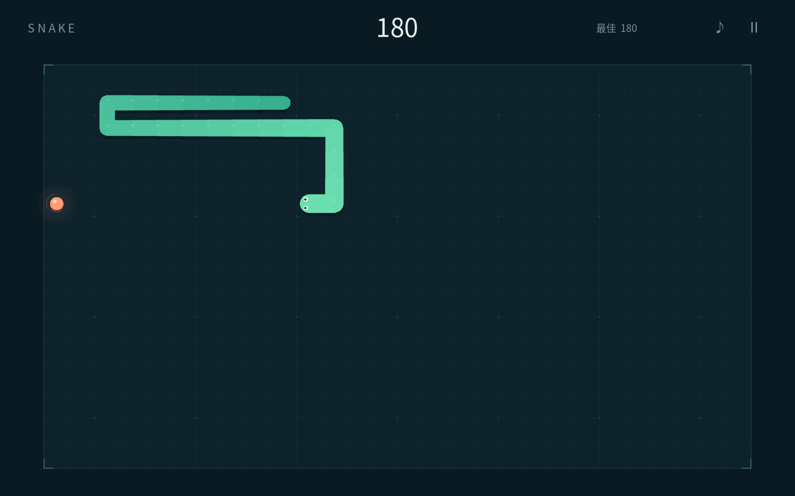

# Snake · 贪吃蛇

一个完整的单人 2D 贪吃蛇小游戏。面向 Godot **4.7.2**，无需插件、网络、账户或额外资源下载。



上图为真实 Godot 渲染的 1440×900 游戏画面，通过正常移动和进食规则达到 180 分。

## 运行

1. 安装 Godot 4.7.2 标准版（不需要 .NET）。
2. 在 Godot 项目管理器中导入此目录的 `project.godot`。
3. 等待字体和 SVG 首次导入，按 **F5** 或点击右上角运行。

命令行：

```sh
godot --path /path/to/SnakeGame
```

项目使用 Compatibility 渲染器。默认窗口 1440×900，可缩放；棋场随可用空间等比布局。鼠标点击开始、暂停和重玩均可。使用触屏时推荐横屏。

## 玩法与操作

在 28×16 的棋场上吃掉橙色光点，每次 +10 分并增长一格；逐渐提速，最短间隔为 0.075 秒。碰到边缘或自己即结束。填满全部 448 格获胜，满分 4440。

| 操作 | 按键 |
| --- | --- |
| 转向 | 方向键 / WASD |
| 开始、结算后重玩 | Enter |
| 暂停、继续 | Esc / 空格 / 顶部暂停按钮 |
| 重新开始 | R |
| 声音开关 | M / 顶部音符按钮 |
| 触屏 | 在棋场上滑动转向 |

玩法说明只在开始/暂停菜单里显示。游戏中没有常驻教程、调试信息或面板侧栏。

### 输入保护

- 禁止直接 180° 掉头。
- 快速连续转向最多预排两个方向，每次移动只应用一个，避免同帧穿透转向。
- 忽略键盘长按重复事件；触控只追踪一根手指。
- 失去窗口焦点自动暂停，切回后手动继续。
- 暂停、重开会清空转向/触控状态；继续和开局有 0.35 秒缓冲。
- 大帧停顿不会连续补算多步导致突然撞墙。
- 没吃食物时，可以进入下一步即将腾出的尾格。

## 结构

```text
scenes/main.tscn        主场景，连接棋场、HUD 与音频节点
scripts/snake_model.gd  无场景依赖的网格规则与随机食物生成
scripts/game.gd         输入、状态流程、计时、失焦暂停
scripts/board_view.gd   棋场、蛇、食物、移动插值与轻量粒子
scripts/hud.gd          菜单、暂停、帮助、结算和顶部 HUD
scripts/save_store.gd   最佳分数与声音偏好保存
scripts/sound_bank.gd   原创程序合成短音效
assets/fonts/          随包中文字体
tests/                 可重复自动测试与渲染取证脚本
```

规则用 `RefCounted` 模型，与渲染、界面和音频解耦，可直接在无界面模式下实例化。运行入口不包含自动驾驶或测试代码。

## 存档

最佳分数和静音设置保存在 Godot `user://snake_save.cfg`，不会写入工程。读入失败时安全使用默认值；无法保存不会中断游戏。请通过 Godot 的“项目 → 打开用户数据文件夹”定位本机数据。

## 测试

首次测试前先导入资源：

```sh
godot --headless --path . --editor --import --quit
godot --headless --path . --script res://tests/test_model_independent.gd
godot --headless --path . --script res://tests/test_save_independent.gd
godot --headless --path . --script res://tests/test_full_game_independent.gd
godot --headless --path . --script res://tests/test_controller_independent.gd
godot --headless --path . --script res://tests/test_integration.gd
```

自动检查包括转向队列与反向保护、四类碰撞边界、空格食物生成、极小棋盘初始化、速度上限、暂停/失焦与计时、触摸释放及多指保护、重开后的延迟回调、坏存档和写入失败。满盘测试通过正常 `tick()` 连续运行 51,390 步、吃到 444 个食物后获胜，未直接指定获胜状态。

建议测试使用隔离的用户数据目录，以免覆盖实际最佳成绩。Linux 可设置 `HOME`、`XDG_DATA_HOME`、`XDG_CONFIG_HOME` 和 `XDG_CACHE_HOME`。

`tests/capture.gd` 在真实 Godot 渲染器中自动驱动规则，采集开始、游玩、暂停、帮助、结算状态，需有图形显示服务，不能使用 `--headless`。测试场景不是游戏运行入口。

```sh
godot --path . --script res://tests/capture.gd -- --capture-dir /absolute/path/to/captures
```

需要独立于桌面尺寸的 1440×900 原生渲染，可使用 `tests/capture_full_resolution.gd`，同样接受 `--capture-dir`。它把完整产品场景放入 Godot SubViewport，自动驱动正常吃食，截图直接取原生渲染纹理，不做图片上采样或修改分数。

不指定目录时输出到 `user://captures`。此脚本会通过正常计分流程更新隔离测试存档的最佳分数，请勿对实际玩家存档运行。

## 美术、字体与许可

- 所有棋场、蛇、食物、粒子与 SVG 图标均由项目内代码原创绘制；没有来自其他游戏的贴图或商业素材。
- 音效由 `sound_bank.gd` 运行时原创合成，无外部采样。
- `NotoSansCJK.ttc`：Noto CJK，SIL Open Font License 1.1。上游为 <https://github.com/notofonts/noto-cjk>，完整随包许可见 `third_party/Noto-LICENSE.txt`。
- 本项目源代码、原创图形及音效采用 MIT 许可，见 `LICENSE`；字体遵循其独立许可。

完整源码交付包含 `project.godot`、场景、脚本、字体和许可。不包含 Godot 引擎二进制，也不需要 `.godot` 缓存。
